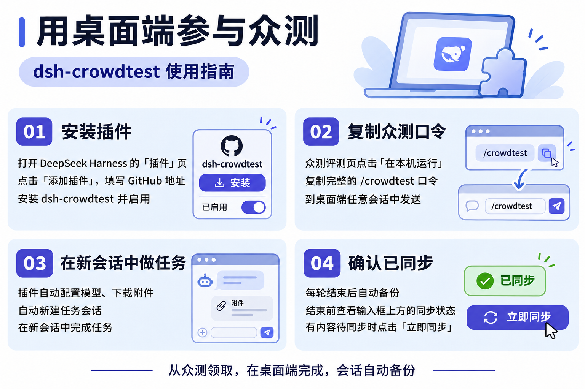

# 用桌面端参与众测

1. 从 [GitHub](https://github.com/kotot/dsh-crowdtest/releases/latest) 下载插件安装包，在 DeepSeek Harness「插件」页添加并启用。
2. 在众测评测页点击「在本机运行」，复制完整命令（含口令和平台地址），在桌面端任意会话中发送。
3. 插件自动配置模型、下载附件并新建任务会话，在新会话中完成任务。
4. 每轮结束自动备份。结束前确认输入框上方显示「已同步」，有内容待同步时点击「立即同步」。

打开已启用的插件详情页会自动检查 GitHub 公开发布，无需配置 GitHub 令牌。有新版时点击右上角「更新到 x.y.z」。安装完成后，完全退出并重新打开 DSH。

若当前使用 0.2.15 且未配置更新令牌，请先从 [GitHub Releases](https://github.com/kotot/dsh-crowdtest/releases/latest) 下载 0.2.16 或更新的安装包，在 DSH「插件」页添加并重启。之后即可直接检查更新。
